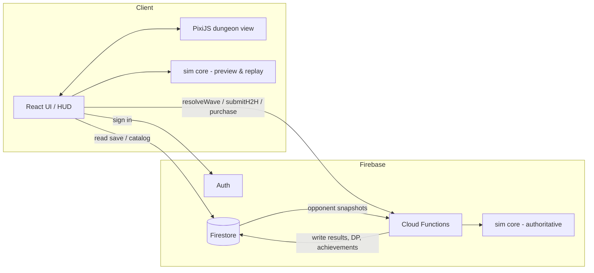

# 00 — Vision & Pillars

## 1. One-line pitch

> You are a **Dungeon Core** — a sentient crystal at the heart of a dungeon. Dig out your lair, populate it with evil monsters, lay traps, and survive escalating waves of heroes who want you dead. Spend the loot of the fallen to grow deadlier, then test your dungeon against other players' dungeons.

## 2. Vision

Dungeon Core is a **single-player-first, asynchronously-social, 2D top-down strategy/management game** about *building a killing machine and watching it work*. The player never directly controls a monster in combat; instead they are an architect and general between waves. The satisfaction loop is **plan → commit → watch it play out → adapt**, closer to an auto-battler / tower-defense hybrid than to an RTS.

The fantasy is the *villain power fantasy*: you are the monster, and the "heroes" are the antagonists invading your home. Early game you are fragile and scrappy (a few goblins and a spike pit). Late game you are a sprawling, multi-biome death labyrinth fielding dragons, liches, and cunning trap networks that shred entire crusades.

## 3. Design pillars

These are the non-negotiable values. When a design decision is ambiguous, resolve it in favor of the higher pillar.

### P1 — Meaningful building, readable combat
Every DP spent should change how the next wave plays out in a way the player can *see and understand*. Combat is auto-resolved but must be **legible**: the player should be able to watch a wave and understand *why* they won or lost (this trap revealed too early, that flank had no defense, the rogue dodged everything because I had no spammers).

### P2 — Depth through composition, not micro
Power comes from **how systems combine** — unit families + research + affinities + gear + trap placement + map shape — not from twitch execution. There is no in-combat control. Difficulty is a *preparation* problem.

### P3 — Distinct, counterable threats
Each enemy archetype/class poses a *specific* question the player must answer with a *specific* tool (rogues ↔ spammers, hordes ↔ AoE/traps, tanks ↔ armor pen/magic, mages ↔ burst/flankers). No single "best" defense; everything has a counter.

### P4 — Tunable everything
All scaling, costs, and content live in data/config so the game can be rebalanced without code changes. The **power-score → tier** mapping is explicitly pluggable (see `04`) because the spec calls for it to be easy to change later.

### P5 — Respect the player's time
Sessions are bite-sized: a round (build + watch a wave) is a few minutes. The game saves constantly. H2H is asynchronous — no waiting on a live opponent. Runs are designed to reach interesting late-game states without grinding for dozens of hours.

### P6 — Server-authoritative & cheat-resistant
Because of H2H and shared content (leaderboards, opponent snapshots), the wave/H2H **simulation is resolved server-side and is deterministic from a seed**. The client is a renderer + planner, never the arbiter of outcomes.

## 4. Target feel & references

- **Dungeon Keeper / War for the Overworld** — the "be the dungeon" fantasy, digging, room building.
- **Tower defense (Bloons TD, Kingdom Rush)** — wave pacing, the build-between-waves rhythm, trap/tower placement.
- **Auto-battlers (TFT, Backpack Battles)** — committing a composition and watching it fight; equipment/affinity optimization.
- **Idle/management progression (Loop Hero)** — long-arc power growth, run-based meta progression.

Tone: dark-comic fantasy. Gleeful villainy, not grimdark. Heroes are a little pompous; monsters have personality.

## 5. Platform & tech stack (summary)

Full detail in `17-architecture.md` and `16-data-model-and-api.md`. Summary:

- **Client**: Web (desktop-first, tablet-friendly). **React + TypeScript + Vite** for UI/menus/HUD; **PixiJS (WebGL)** for the dungeon viewport (tiles, sprites, animation, drag-drop, FX). **Zustand** for client state. Built and served via **Firebase Hosting**.
- **Backend**: **Firebase** — **Auth** (accounts), **Cloud Firestore** (persistent saves, profiles, achievements, H2H opponent pool, leaderboards), **Cloud Functions (TypeScript)** for the **authoritative simulation**, economy validation, H2H matchmaking/resolution, and achievement granting.
- **Shared simulation core**: a pure, dependency-free TypeScript package (`sim/`) imported by *both* the client (for instant local preview/replay) and Cloud Functions (for authoritative resolution). Same code, same seed, same result. See `17`.

## 6. The top-level loop (one sentence each)

1. **Dig** out tiles to shape your dungeon (must keep a path from the entrance to the core).
2. **Populate** opened tiles with monsters (limited by Capacity), **turrets**, and **traps**.
3. **Equip** monsters with weapons/armor (gated by tier & affinity).
4. **Run a wave**: adventurers spawn at the entrance, explore, fight your monsters/traps, and try to reach and destroy the core.
5. **Collect DP** (and sometimes gear drops) from defeated invaders.
6. **Invest**: upgrade the **Core Level** (more capacity/size/features), buy **research** (unlock units & family upgrades), buy more units/traps/expansions.
7. **Escalate**: each wave is tougher; repeat until the core dies (run ends, state + achievements saved) — or take your saved dungeon into **H2H** against another player's snapshot.

## 7. What success looks like (product goals)

- A first-time player completes the tutorial and *gets* the loop within ~10 minutes.
- A typical run lasts ~30–90 minutes of active play and reaches at least mid-tier content (T4–T6).
- The "watch the wave" moment is genuinely fun to spectate, not a black box.
- Players return for: pushing higher waves, completing achievements, optimizing builds, and beating H2H opponents.

## 8. Non-goals (v1)

- No real-time multiplayer / live PvP (H2H is async by design — pillar P5/P6).
- No direct in-combat unit control (pillar P2).
- No monetization systems designed in v1 (architecture shouldn't preclude cosmetics later, but it's out of scope).
- No mobile-native build (responsive web only).
- No procedural narrative/quests beyond flavor; this is a systems game.
