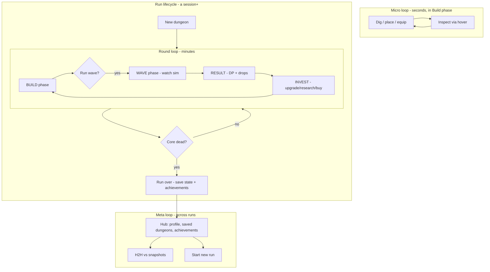
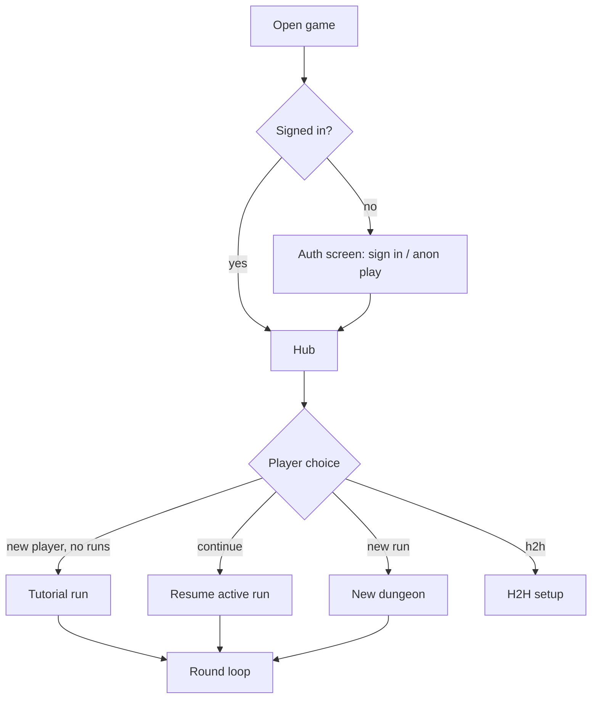

# 01 — Game Loop & Sessions

This document defines the structure of play at every timescale: the per-round loop, the run lifecycle, the session shape, and the win/loss rules. Numbers referenced here (DP, capacity, scaling) are defined canonically in `02-core-and-economy.md` and `11-balancing-and-formulas.md`.

---

## 1. Loop timescales

---

## 2. Round loop (the heartbeat)

A **round** = one iteration of BUILD → WAVE → RESULT → INVEST. The wave counter `W` increments each round (W1, W2, …). Each round is a few minutes of player time.

### 2.1 BUILD phase
The dungeon is paused. The player can freely:
- **Dig** tiles with the pickaxe (spends DP, see `03`).
- **Place / move / sell** units, turrets, and traps (drag-and-drop; selling refunds a fraction, see `02`).
- **Equip / unequip** gear via hover panel (see `07`, `14`).
- **Spend DP** on: Core Level upgrade, research nodes, new units/traps/turrets/expansions, and (CL≥3) buying gear.
- **Inspect** anything by hovering (stats, affinities, equipment, trap hidden-rating estimate).
- **Preview** the incoming wave's *composition and tier* (not exact AI behavior) via a "Scout" readout — telegraphing the threat so building is informed (pillar P1/P3).

There is **no time limit** on BUILD. The player commits by pressing **Run Wave**.

`[R-LOOP-001]` The player may save and quit during BUILD with zero loss of progress.
`[R-LOOP-002]` The incoming wave's archetype mix, group type, and tier band are shown before committing; exact unit count may be shown as a range until CL unlocks a "Full Scout" feature.

### 2.2 WAVE phase
The dungeon runs the **deterministic simulation** (see `10-combat-and-ai.md`). Adventurers spawn at the entrance and execute their AI. The player **watches** and may:
- Change **playback speed** (1×/2×/4×, and instant-resolve).
- **Pan/zoom** the camera; click a combatant to follow it and see a live stat/HP readout.
- **Not** intervene. There are no active abilities in v1. (Design space reserved for "Core Powers" later — see §6.)

The wave ends when **either**:
- All adventurers are dead/retreated → **wave cleared** (player success), or
- The **core HP reaches 0** → **run over** (see §4).

`[R-LOOP-010]` The WAVE phase outcome is computed authoritatively server-side; the client plays back the returned timeline. Local "instant preview" may run the same sim client-side for responsiveness but is overwritten by the server result of record (see `12`/`16`).

### 2.3 RESULT phase
A summary screen shows:
- **DP earned** (per-kill breakdown + wave-clear bonus).
- **Gear drops** (if any) added to inventory.
- **Casualties**: which of the player's units died. (See §5 for unit death/persistence rules.)
- **Notable events**: "Sir Aldric (Unique) reached the core", "Spike Pit triggered 6 times", etc. (drives P1 legibility).
- **Achievement** unlocks, if any.

### 2.4 INVEST phase
Functionally part of the next BUILD; called out separately because it's where the strategic decisions live. The player allocates the DP just earned. The tension is **breadth vs. depth vs. tempo**:
- Save for a **Core Level** (long-term capacity/size/unlocks)?
- Buy **research** (unlock a new unit/family upgrade)?
- Buy **more units / better placement / traps** for immediate survival?
- **Expand** the map to create better kill-corridors?

---

## 3. Wave escalation

Each round, the threat increases. The wave generator (see `09-enemies-and-classes.md` §Wave Generation and `11-balancing-and-formulas.md`) scales along several axes as `W` grows:

| Axis | Behavior over waves |
|------|---------------------|
| **Budget** | A "threat budget" grows (roughly exponential early, softening later) and is spent buying adventurers. |
| **Tier band** | The min/max adventurer tier rises; early waves are T1–T2, later waves push toward T10. |
| **Group type** | Progresses Solo → Party → Horde → Crusade, with reversions for variety. |
| **Class specialization** | Higher tiers unlock specialized classes (see class trees, `09`). |
| **Uniques** | Named leaders appear more often and stronger in later/larger groups. |

`[R-LOOP-020]` The threat budget formula and tier-band schedule are config constants (`11`), not hardcoded, so pacing is tunable.
`[R-LOOP-021]` Every Nth wave (default N=5) is a **telegraphed "Crusade" milestone wave** — larger, with guaranteed uniques and a bigger reward — giving runs a rhythm of build-up and payoff.

---

## 4. Win / loss & run end

- **There is no "win"** in the endless sense — a run is a survival score. The player "wins" a round by clearing its wave.
- **Loss / run end**: the core's HP reaches 0 during a wave. The run ends immediately at the end of that wave's playback.
- The player may also **voluntarily retire** a dungeon from the hub (banks it as a saved snapshot for H2H, ends the run).

On run end (`[R-LOOP-030]`):
1. The **final dungeon state** is saved as a named snapshot (auto-named, renameable) under the account.
2. **Achievements** earned this run are committed.
3. Run stats recorded: highest wave reached, total DP earned, max Core Level, total kills, run duration, biggest single wave cleared, etc.
4. The player returns to the **hub** with options: start a new run, view/borrow a saved dungeon as a new run's starting template (if unlocked), or enter **H2H**.

`[R-LOOP-031]` Death is **not** fully punishing: the saved snapshot is reusable in H2H, and meta-progression (achievements, unlocked cosmetic flair, optional "New Game+" modifiers — see `13`) persists. The spec explicitly wants saved final state + achievements to persist.

---

## 5. Unit & resource persistence within a run

- **DP** carries across rounds within a run (it's the run currency). It does **not** carry across runs.
- **Units**: A monster placed in the dungeon persists between waves. If a monster **dies during a wave**, by default it **revives at the start of the next BUILD phase** at no cost (design rationale: keeps the loop about preparation, not attrition grinding; the *threat* is the core dying, not unit churn). 
  - `[R-LOOP-040]` This "free revive" is a tunable rule. A harder mode (`hardcore`) instead makes deaths permanent and requires re-buying. Default = revive ON. See `13` New Game+ modifiers.
- **Gear** dropped by enemies is permanent inventory for the run; equipping/unequipping is free.
- **Traps**: consumable vs. reusable is per-trap-type (see `08`). Most traps are **reusable** but have a **per-wave trigger cooldown / charges**; some high-impact traps are **one-shot consumed** and must be rebought.

---

## 6. Reserved design space (not v1, do not block on these)

- **Core Powers**: limited active abilities the player can trigger during a wave (e.g., a one-time heal or AoE), on long cooldowns. Architecture should not preclude an in-wave input channel.
- **Biomes/themes** affecting tiles and granting family bonuses.
- **Seasonal H2H ladders / leaderboards** beyond the basic version in `12`.

---

## 7. Session flow (cold start → playing)

`[R-LOOP-050]` If the player has an **active (un-ended) run**, the hub surfaces a prominent "Continue" that resumes exactly where they left off (BUILD phase of the current round).
`[R-LOOP-051]` First-ever session routes new players into the tutorial (see `15-tutorial-onboarding.md`), which is a constrained scripted run.

---

## 8. Pacing targets (for balancing, see `11`)

| Metric | Target |
|--------|--------|
| Time per round (BUILD + watch a normal wave at 2×) | 2–4 min |
| Waves to first Core Level up | ~3–5 |
| Waves to unlock 2nd unit family | ~8–12 |
| Typical run length (active) | 30–90 min |
| Waves reached in a "good" run | 25–50 |
| Milestone (Crusade) wave cadence | every 5 waves |
| H2H match length | ≤ ~10 rounds (enforced by escalating baseline, see `12`) |
