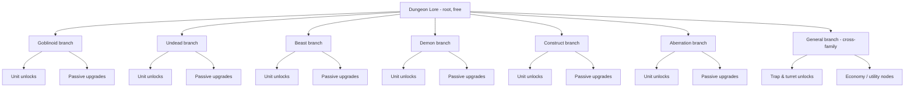

# 06 — Research Tree

Research is the **unlock layer**: it spends DP to (a) unlock units for purchase and (b) buy **family-wide upgrades** ("all goblinoid units gain X"). Research is per-run (resets each new run) and gated by **Research Tier (R1–R10)**, which is unlocked by Core Level (`02` §2.1).

> Spec: "a unit research tree... unlock units, or unlock upgrades for unit subsets... Upgrade would be like all goblinoid units gain x in some stat."

---

## 1. Structure



### 1.1 Node types
| Type | Effect |
|------|--------|
| `unlockUnit` | Makes a unit purchasable (still gated by CL Max-Tier). |
| `familyUpgrade` | Permanent stat/ability buff to all units of a family (stacks across ranks). |
| `crossUpgrade` | Buff spanning roles (e.g., "all ranged units +range"). |
| `unlockContent` | Unlocks a trap type, turret mode, or feature. |
| `economy` | DP income / cost reduction / capacity efficiency perks. |

### 1.2 Node schema
```ts
interface ResearchNode {
  id: string;
  branch: 'goblinoid'|'undead'|'beast'|'demon'|'construct'|'aberration'|'general';
  type: 'unlockUnit'|'familyUpgrade'|'crossUpgrade'|'unlockContent'|'economy';
  researchTier: number;        // R1..R10, gated by CL
  cost: number;                // DP
  prereqs: string[];           // node ids that must be owned
  ranks?: number;              // for repeatable upgrades (default 1)
  effect: ResearchEffect;      // declarative: { unlockUnitId } | { family, stat, add|mult } | ...
}
```

`[R-RES-001]` A node is purchasable iff: `CL` unlocks its `researchTier`, all `prereqs` owned, DP ≥ `cost`, and (for ranked) current rank < max.
`[R-RES-002]` Research is **not refundable** (`02` §4.3).
`[R-RES-003]` `familyUpgrade` effects are applied in the sim as additive/multiplicative modifiers on top of base stats **after** tier is computed (so they don't change tier; they're a run-power layer). Multiple ranks stack additively unless noted.

### 1.3 Research Tier ↔ cost scaling
Node cost scales with research tier: `cost = ROUND( RES_BASE * RES_TIER_MULT^(researchTier-1) * nodeWeight )`, defaults `RES_BASE = 40`, `RES_TIER_MULT = 1.7`. `nodeWeight`: unit-unlock 1.0, minor upgrade 0.8, major upgrade 1.5, capstone 3.0 (config in `11`).

---

## 2. General branch (cross-family + content unlocks)

| id | Tier | Type | Cost~ | Prereq | Effect |
|----|-----:|------|------:|--------|--------|
| `res_root` | R1 | — | 0 | — | Root; unlocks the tree. |
| `res_basic_traps` | R1 | unlockContent | 32 | root | Unlock Tier-1 trap types (`08`). |
| `res_turrets` | R1 | unlockContent | 40 | root | Unlock turret placement (also gated CL2). |
| `res_scout` | R2 | economy | 60 | root | +info on incoming waves (synergy w/ CL Full Scout). |
| `res_salvage` | R2 | economy | 68 | root | +10% DP from kills (rank 3). |
| `res_efficient_digging` | R2 | economy | 56 | root | −20% dig cost. |
| `res_ranged_doctrine` | R3 | crossUpgrade | 120 | res_scout | All ranged units +1 `range`, +10% `acc` (counters rogues). |
| `res_melee_doctrine` | R3 | crossUpgrade | 120 | root | All melee units +8% `phys`, +5% `def`. |
| `res_arcane_doctrine` | R3 | crossUpgrade | 130 | root | All casters +10% `mag`, +`magPen`. |
| `res_adv_traps` | R4 | unlockContent | 200 | res_basic_traps | Unlock Tier-2/3 traps incl. anti-rogue traps. |
| `res_capacity_logistics` | R4 | economy | 220 | res_salvage | +6% effective Capacity (rounding) per rank (rank 2). |
| `res_turret_mobility` | R5 | unlockContent | 320 | res_turrets | Turrets gain reposition/flee behavior. |
| `res_elite_traps` | R6 | unlockContent | 560 | res_adv_traps | Unlock high-tier & field traps (CL6 field placement). |
| `res_grand_doctrine` | R8 | crossUpgrade | 1900 | doctrines×2 | +12% all primary stats, cross-family. |
| `res_apex_logistics` | R9 | economy | 3200 | res_capacity_logistics | +15% Capacity, −15% unit cost. |

---

## 3. Per-family branches

Each family branch follows the same template so authoring is uniform:

- **Unit unlocks** at the tiers that family has units (some units start pre-unlocked at R1 so the player can play immediately).
- **Passive upgrades** in 2–3 lines: an offense line, a defense/utility line, and a signature-mechanic line — each with ranks.
- A **family capstone** at R8–R10 that unlocks the T10 unit and grants a powerful family-wide effect.

`[R-RES-010]` Each family's **T1 unit(s)** are unlocked by default (cost 0, owned at run start) for at least the player's chosen "starter family"; others require their unlock node. (Starter selection: v1 unlocks all six T1 bodies cheaply so players can experiment; tunable.)

### 3.1 Goblinoid branch

| id | Tier | Type | Cost~ | Prereq | Effect |
|----|-----:|------|------:|--------|--------|
| `res_gob_grunt` | R1 | unlockUnit | 0 | root | Unlock `gob_grunt`, `gob_archer` (starter). |
| `res_gob_ferocity` | R1 | familyUpgrade ×5 | 36 | gob_grunt | Goblinoids +6% `phys` per rank. |
| `res_gob_pack` | R2 | familyUpgrade ×3 | 64 | gob_ferocity | Goblinoids +5% `phys`/`def` per adjacent goblinoid (max 3) per rank. |
| `res_gob_cutter` | R2 | unlockUnit | 56 | gob_grunt | Unlock `gob_cutter`. |
| `res_gob_orcs` | R3 | unlockUnit | 120 | gob_cutter | Unlock `orc_warrior`, `orc_shaman`. |
| `res_gob_resilience` | R3 | familyUpgrade ×3 | 100 | gob_grunt | Goblinoids +10% `hp` per rank. |
| `res_gob_ogre` | R4 | unlockUnit | 200 | gob_orcs | Unlock `gob_ogre`. |
| `res_gob_warlord` | R5 | unlockUnit | 330 | gob_ogre | Unlock `orc_warlord`. |
| `res_gob_frenzy` | R5 | familyUpgrade ×3 | 300 | gob_ferocity | Goblinoids +8% `atkSpeed` per rank. |
| `res_gob_troll` | R6 | unlockUnit | 560 | gob_warlord | Unlock `gob_troll`. |
| `res_gob_matron` | R7 | unlockUnit | 980 | gob_troll | Unlock `gob_battlemother`. |
| `res_gob_warbringer` | R8 | unlockUnit | 1700 | gob_matron | Unlock `gob_warbringer`. |
| `res_gob_titan` | R9 | unlockUnit | 2900 | gob_warbringer | Unlock `gob_titan`. |
| `res_gob_capstone` | R10 | unlockUnit + familyUpgrade | 5200 | gob_titan | Unlock `gob_godslayer`; goblinoids +15% all stats. |

### 3.2 Undead branch

| id | Tier | Type | Cost~ | Prereq | Effect |
|----|-----:|------|------:|--------|--------|
| `res_und_skeleton` | R1 | unlockUnit | 0 | root | Unlock `und_skeleton` (starter). |
| `res_und_archer` | R2 | unlockUnit | 56 | und_skeleton | Unlock `und_skel_archer`. |
| `res_und_necromancy` | R2 | familyUpgrade ×3 | 70 | und_skeleton | Fallen undead have X% chance to revive at wave start per rank. |
| `res_und_ghoul` | R3 | unlockUnit | 120 | und_skeleton | Unlock `und_ghoul`. |
| `res_und_soulmagic` | R3 | familyUpgrade ×3 | 110 | und_skeleton | Undead casters +8% `mag`, +`shadow` affinity per rank. |
| `res_und_necromancer` | R4 | unlockUnit | 200 | und_ghoul | Unlock `und_necromancer`. |
| `res_und_wight` | R5 | unlockUnit | 330 | und_necromancer | Unlock `und_wight`, `und_wraith`. |
| `res_und_bonegolem` | R6 | unlockUnit | 560 | und_wight | Unlock `und_bonegolem`. |
| `res_und_decay` | R6 | familyUpgrade ×3 | 520 | und_soulmagic | Undead attacks apply stacking −def debuff per rank. |
| `res_und_lich` | R7 | unlockUnit | 980 | und_bonegolem | Unlock `und_lich`. |
| `res_und_deathknight` | R8 | unlockUnit | 1700 | und_lich | Unlock `und_deathknight`. |
| `res_und_archlich` | R9 | unlockUnit | 2900 | und_deathknight | Unlock `und_archlich`. |
| `res_und_capstone` | R10 | unlockUnit + familyUpgrade | 5200 | und_archlich | Unlock `und_deathlord`; mass-revive aura + undead +15% stats. |

### 3.3 Beast branch

| id | Tier | Type | Cost~ | Prereq | Effect |
|----|-----:|------|------:|--------|--------|
| `res_bst_wolf` | R1 | unlockUnit | 0 | root | Unlock `bst_direwolf` (starter). |
| `res_bst_predation` | R1 | familyUpgrade ×5 | 36 | bst_wolf | Beasts +5% `crit` & +0.05 `moveSpeed` per rank. |
| `res_bst_spider` | R2 | unlockUnit | 56 | bst_wolf | Unlock `bst_giantspider`. |
| `res_bst_venom` | R2 | familyUpgrade ×3 | 70 | bst_spider | Beast DoTs +25% per rank. |
| `res_bst_harpy` | R3 | unlockUnit | 120 | bst_wolf | Unlock `bst_harpy` (anti-rogue ranged). |
| `res_bst_basilisk` | R4 | unlockUnit | 200 | bst_spider | Unlock `bst_basilisk`. |
| `res_bst_manticore` | R5 | unlockUnit | 330 | bst_basilisk | Unlock `bst_manticore`. |
| `res_bst_apex` | R5 | familyUpgrade ×3 | 300 | bst_predation | Beasts +8% `acc` & `atkSpeed` per rank. |
| `res_bst_wyvern` | R6 | unlockUnit | 560 | bst_manticore | Unlock `bst_wyvern`. |
| `res_bst_chimera` | R7 | unlockUnit | 980 | bst_wyvern | Unlock `bst_chimera`. |
| `res_bst_behemoth` | R8 | unlockUnit | 1700 | bst_chimera | Unlock `bst_behemoth`. |
| `res_bst_roc` | R9 | unlockUnit | 2900 | bst_behemoth | Unlock `bst_rocdragon`. |
| `res_bst_capstone` | R10 | unlockUnit + familyUpgrade | 5200 | bst_roc | Unlock `bst_worldserpent`; beasts +15% stats. |

### 3.4 Demon branch

| id | Tier | Type | Cost~ | Prereq | Effect |
|----|-----:|------|------:|--------|--------|
| `res_dem_imp` | R1 | unlockUnit | 0 | root | Unlock `dem_imp` (starter). |
| `res_dem_infernal_aff` | R2 | familyUpgrade ×3 | 70 | dem_imp | Demons +8% `fire`/`arcane` effectiveness per rank. |
| `res_dem_hellhound` | R2 | unlockUnit | 56 | dem_imp | Unlock `dem_hellhound`. |
| `res_dem_cambion` | R3 | unlockUnit | 120 | dem_imp | Unlock `dem_cambion`. |
| `res_dem_succubus` | R4 | unlockUnit | 200 | dem_cambion | Unlock `dem_succubus`. |
| `res_dem_dominion` | R4 | familyUpgrade ×3 | 200 | dem_imp | Demon fear/aura radius +1 & +10% potency per rank. |
| `res_dem_barbed` | R5 | unlockUnit | 330 | dem_succubus | Unlock `dem_barbed`. |
| `res_dem_infernal` | R6 | unlockUnit | 560 | dem_barbed | Unlock `dem_infernal`. |
| `res_dem_pitfiend` | R7 | unlockUnit | 980 | dem_infernal | Unlock `dem_pitfiend`. |
| `res_dem_balor` | R8 | unlockUnit | 1700 | dem_pitfiend | Unlock `dem_balor`. |
| `res_dem_archdevil` | R9 | unlockUnit | 2900 | dem_balor | Unlock `dem_archdevil`. |
| `res_dem_capstone` | R10 | unlockUnit + familyUpgrade | 5200 | dem_archdevil | Unlock `dem_demonprince`; demons +15% stats. |

### 3.5 Construct branch

| id | Tier | Type | Cost~ | Prereq | Effect |
|----|-----:|------|------:|--------|--------|
| `res_con_armor` | R1 | unlockUnit | 0 | root | Unlock `con_animarmor` (starter). |
| `res_con_fortify` | R1 | familyUpgrade ×5 | 36 | con_armor | Constructs +8% `hp`/`def` per rank. |
| `res_con_sentry` | R2 | unlockUnit | 56 | con_armor | Unlock `con_sentry` (turret base). |
| `res_con_ironguard` | R3 | unlockUnit | 120 | con_armor | Unlock `con_ironguard`. |
| `res_con_siege` | R3 | familyUpgrade ×3 | 110 | con_sentry | Constructs +`armorPen` & +10% `rng` per rank. |
| `res_con_ballista` | R4 | unlockUnit | 200 | con_sentry | Unlock `con_ballista` (turret). |
| `res_con_stonegolem` | R5 | unlockUnit | 330 | con_ironguard | Unlock `con_stonegolem`. |
| `res_con_arcaneturret` | R6 | unlockUnit | 560 | con_ballista | Unlock `con_arcaneturret` (turret). |
| `res_con_irongolem` | R6 | unlockUnit | 560 | con_stonegolem | Unlock `con_irongolem`. |
| `res_con_colossus` | R7 | unlockUnit | 980 | con_irongolem | Unlock `con_colossus`. |
| `res_con_sentinel` | R8 | unlockUnit | 1700 | con_colossus | Unlock `con_sentinel`. |
| `res_con_titanforge` | R9 | unlockUnit | 2900 | con_sentinel | Unlock `con_titanforge`. |
| `res_con_capstone` | R10 | unlockUnit + familyUpgrade | 5200 | con_titanforge | Unlock `con_worldengine`; constructs +15% stats + ally def aura. |

### 3.6 Aberration branch

| id | Tier | Type | Cost~ | Prereq | Effect |
|----|-----:|------|------:|--------|--------|
| `res_abr_ooze` | R1 | unlockUnit | 0 | root | Unlock `abr_ooze` (starter). |
| `res_abr_eyes` | R1 | familyUpgrade ×3 | 40 | abr_ooze | Aberrations +`detection` radius & +acc vs stealth per rank (anti-rogue). |
| `res_abr_gazer` | R2 | unlockUnit | 56 | abr_ooze | Unlock `abr_gazer`. |
| `res_abr_mindling` | R3 | unlockUnit | 120 | abr_gazer | Unlock `abr_mindling`. |
| `res_abr_aberrant` | R3 | familyUpgrade ×3 | 120 | abr_ooze | Aberration debuffs +20% potency/duration per rank. |
| `res_abr_chokethorn` | R4 | unlockUnit | 200 | abr_mindling | Unlock `abr_chokethorn`. |
| `res_abr_beholder` | R5 | unlockUnit | 330 | abr_gazer | Unlock `abr_beholder`. |
| `res_abr_hivemind` | R6 | unlockUnit | 560 | abr_beholder | Unlock `abr_hivemind`. |
| `res_abr_mindflayer` | R7 | unlockUnit | 980 | abr_hivemind | Unlock `abr_mindflayer`. |
| `res_abr_starspawn` | R8 | unlockUnit | 1700 | abr_mindflayer | Unlock `abr_nightgaunt`. |
| `res_abr_elderbrain` | R9 | unlockUnit | 2900 | abr_starspawn | Unlock `abr_elderbrain`. |
| `res_abr_capstone` | R10 | unlockUnit + familyUpgrade | 5200 | abr_elderbrain | Unlock `abr_outergod`; aberrations +15% stats + global debuff aura. |

---

## 4. Strategy notes (for balance & UI)

- A player cannot afford every branch in one run; **specialization** is forced by DP scarcity (pillar P2). Research costs are tuned so ~1–2 families + select general nodes are realistic in a deep run.
- `familyUpgrade` ranks create **scaling identity**: e.g., a goblin-swarm build leans `ferocity`+`pack`+`frenzy` to make cheap T1–T3 bodies punch up.
- Cross-family `doctrine` nodes let hybrid builds patch weaknesses (e.g., `res_ranged_doctrine` to shore up anti-rogue).
- `[R-RES-020]` The UI presents research as a per-family panel with the dependency graph (see `14`), greys out CL-locked tiers, and shows effect previews.

## 5. Validation

`[R-RES-030]` Every `unlockUnit` node must reference a real unit id in `05`. Every `familyUpgrade` must reference a real family + valid stat key. Build a content test that cross-checks `06` ↔ `05`.
`[R-RES-031]` The tree must be acyclic; prereqs only point to lower/equal research tiers.
