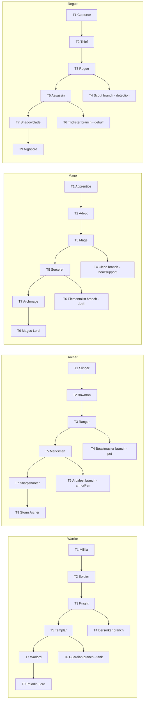

# 09 — Enemies, Classes & Wave Generation

The adventurers who invade the dungeon. Defines the four base **archetypes**, their **class evolution trees** across tiers, the **rogue detection/dodge** math, **named uniques**, **group types**, and how **waves are generated** and scaled.

---

## 1. Archetypes (base roles)

Spec: "warriors archers mages rogues."

| Archetype | Identity | Signature stats | Counter (what the player should bring) |
|-----------|----------|-----------------|----------------------------------------|
| **Warrior** | Frontline melee, durable | `hp`,`def`,`phys`,`block` | armorPen, magic, AoE, kiting |
| **Archer** | Ranged physical DPS | `rng`,`range`,`acc`,`atkSpeed` | high HP front, dodge tanks, fast closers, cover (corners) |
| **Mage** | Ranged magic, AoE/burst | `mag`,`range`,`magPen` | high `mres`, burst/assassins to kill backline, silence traps |
| **Rogue** | Evasive, trap-revealing infiltrator | `dodge`,`stealth`,`detection`,`crit`,`moveSpeed` | **spammers** (high-speed ranged volume), anti-rogue traps (net/truesight), detection units (aberrations) |

`[R-ENE-001]` Each adventurer is an instance of a **class** (a specialization of an archetype) at a given **tier**, with stats authored to that tier's power budget (`04`), plus archetype/class abilities.

---

## 2. Class evolution trees

Spec: "They also have classes, they evolve with each tier, so higher tier enemies have more specialized classes... probably just have like 1 straightforward path for each archetype. also, make a few more classes."

Design: each archetype has a **mainline** progression (the "straightforward path") plus **branch classes** that appear at higher tiers for variety/specialization. Class determines stat emphasis + abilities; tier determines magnitude.



### 2.1 Class table (canonical)

> Stats authored to tier budget (`04` §2). `atk` column = the class's main attack stat value (phys for warrior/rogue, rng for archer, mag for mage). Abilities are from the shared library (`04` §6) + enemy-specific ones noted.

#### Warrior line
| id | Class | Tier | hp | def | atk(phys) | Key stats / abilities |
|----|-------|-----:|---:|----:|----------:|------------------------|
| `adv_w_militia` | Militia | T1 | 140 | 10 | 22 | baseline; `block .05` |
| `adv_w_soldier` | Soldier | T2 | 230 | 17 | 38 | `block .1`, shield |
| `adv_w_knight` | Knight | T3 | 380 | 28 | 64 | `block .15`, high `threat` |
| `adv_w_berserker` | Berserker (branch) | T4 | 560 | 24 | 130 | low def, high `phys`+`atkSpeed`, `executeLowHp` |
| `adv_w_templar` | Templar | T5 | 920 | 60 | 165 | `holy` dmg, `mres` up, self-heal |
| `adv_w_guardian` | Guardian (branch) | T6 | 1700 | 120 | 210 | mega tank, `block .25`, taunt aura |
| `adv_w_warlord` | Warlord | T7 | 2300 | 140 | 460 | buff aura to party (+phys) |
| `adv_w_paladin` | Paladin-Lord | T9 | 6000 | 320 | 1280 | party-wide ward, `holy` smite, anti-undead |

#### Archer line
| id | Class | Tier | hp | def | atk(rng) | Key stats / abilities |
|----|-------|-----:|---:|----:|---------:|------------------------|
| `adv_a_slinger` | Slinger | T1 | 95 | 5 | 22 | `range 4` |
| `adv_a_bowman` | Bowman | T2 | 150 | 9 | 38 | `range 5`,`atkSpeed 1.1` |
| `adv_a_ranger` | Ranger | T3 | 250 | 14 | 62 | `range 5`, high `acc` (anti-rogue-mob? no—accurate), `moveSpeed` |
| `adv_a_beastmaster` | Beastmaster (branch) | T4 | 460 | 22 | 90 | summons a pet wolf add; `range 5` |
| `adv_a_marksman` | Marksman | T5 | 700 | 40 | 165 | `range 6`, `crit .2`, `armorPen` |
| `adv_a_arbalest` | Arbalest (branch) | T6 | 1200 | 70 | 250 | crossbow, heavy `armorPen`, slow |
| `adv_a_sharpshooter` | Sharpshooter | T7 | 1900 | 110 | 450 | `range 7`, huge `crit`, headshot `executeLowHp` |
| `adv_a_storm` | Storm Archer | T9 | 5500 | 290 | 1280 | multi-shot `splash`, very high `atkSpeed` |

#### Mage line
| id | Class | Tier | hp | def | atk(mag) | Key stats / abilities |
|----|-------|-----:|---:|----:|---------:|------------------------|
| `adv_m_apprentice` | Apprentice | T1 | 80 | 4 | 24 | `range 5` |
| `adv_m_adept` | Adept | T2 | 130 | 7 | 40 | `range 5`, small `splash` |
| `adv_m_mage` | Mage | T3 | 220 | 12 | 66 | `range 6`, `splash`, `magPen` |
| `adv_m_cleric` | Cleric (branch) | T4 | 420 | 24 | 70 | **heals party** (key support; priority kill), ward |
| `adv_m_sorcerer` | Sorcerer | T5 | 700 | 38 | 175 | `range 6`, big `splash` |
| `adv_m_elementalist` | Elementalist (branch) | T6 | 1200 | 60 | 290 | multi-school AoE, `range 7` |
| `adv_m_archmage` | Archmage | T7 | 1900 | 110 | 470 | huge AoE burst, `magPen`, slow field |
| `adv_m_magus` | Magus-Lord | T9 | 5400 | 280 | 1380 | nukes, party `mres` buff, teleport |

#### Rogue line
| id | Class | Tier | hp | def | atk(phys) | Key stats / abilities |
|----|-------|-----:|---:|----:|----------:|------------------------|
| `adv_r_cutpurse` | Cutpurse | T1 | 90 | 5 | 24 | `dodge .15`,`stealth .2`,`detection 20`,`moveSpeed 1.4` |
| `adv_r_thief` | Thief | T2 | 140 | 8 | 40 | `dodge .2`,`detection 30` |
| `adv_r_rogue` | Rogue | T3 | 240 | 13 | 64 | `dodge .28`,`stealth .35`,`detection 45`, reveal radius 3 |
| `adv_r_scout` | Scout (branch) | T4 | 420 | 20 | 80 | massive `detection`, reveal radius 5, low dodge — the trap-buster |
| `adv_r_assassin` | Assassin | T5 | 680 | 36 | 175 | `dodge .35`,`crit .35`,`firstStrike`, targets backline |
| `adv_r_trickster` | Trickster (branch) | T6 | 1150 | 60 | 250 | debuffs your units (−acc/−atkSpeed), `dodge .3` |
| `adv_r_shadowblade` | Shadowblade | T7 | 1850 | 100 | 460 | `dodge .42`,`stealth .6`, blink, reveal radius 6 |
| `adv_r_nightlord` | Nightlord | T9 | 5300 | 270 | 1280 | `dodge .5`, party stealth aura, mass trap reveal |

`[R-ENE-010]` Tiers without a listed class for a line use the nearest lower class scaled up, or a tweened entry; the content pipeline fills gaps so every tier T1–T10 has at least the four mainline classes available (T8/T10 entries are tweened from neighbors or added in `19`).
`[R-ENE-011]` Branch classes appear only from their tier upward and are weighted to appear more in larger groups / later waves (specialization rises with tier, per spec).

---

## 3. Rogue mechanics (detection & dodge) — canonical math

Spec: "rogues have some radius and some skill, and all traps become apparent within that radius, and your units have leq .9 probability of hitting them, goes down with rogue skill."

`[R-ROGUE-001]` **Trap reveal**: within a rogue's `revealRadius`, **all** player traps become revealed (shared to the whole party). Higher-tier rogues have larger radius (table above). Scouts specialize in this.
`[R-ROGUE-002]` **Hit chance vs rogue**: a player unit attacking a rogue has hit probability
```
pHit = clamp( BASE_HIT_VS_ROGUE - rogue.dodge_skill_factor + attacker.accBonus , floor, 0.9 )
```
- `BASE_HIT_VS_ROGUE = 0.9` (the spec's ≤0.9 cap).
- `rogue.dodge_skill_factor` rises with rogue tier/class (their `dodge` stat drives it). So higher "skill" → lower hit chance.
- `attacker.accBonus` from `acc` stat, `res_ranged_doctrine`, `+acc` affixes, and **detection** units negating stealth. This is how the player claws hit chance back up.
- `floor` default 0.25 (you can always *sometimes* hit).
`[R-ROGUE-003]` **Anti-rogue counters** (the counter-web, pillar P3):
  - **Spammers**: high `atkSpeed` ranged units (Goblin Slinger, Harpy, archers) — even at reduced `pHit`, **volume** of attacks ensures hits land (spec: "countered by spammers that shoot a lot, high speed ranged units"). The math: expected hits/sec = `atkSpeed * pHit`; spammers win on the `atkSpeed` term.
  - **Anti-rogue traps**: `trap_net` (strips dodge), `trap_revealward` (removes dodge & stealth in radius) — turn `pHit` back toward normal.
  - **Detection units**: aberrations (`abr_gazer`,`abr_beholder`) and `+detection` gear reduce rogue `stealth`'s contribution, raising `pHit`.
`[R-ROGUE-004]` Revealed traps are **avoided** by adventurer pathing if an alternate route exists; if the only route is trapped, they take it (the fair-lane rule, `03` §5, guarantees there's always *a* trap-free route, but the player designs the map so the trap-free route is long/exposed).

---

## 4. Named Uniques

Spec: "special named opponents that have the unique tag that are stronger... generally leaders of the parties."

`[R-UNIQ-001]` A unique is a class instance with: the `unique` tag, a **name**, a **stat multiplier** (`UNIQUE_STAT_MULT`, default ×1.6–2.2 by group size), **bonus abilities** (often an aura buffing their party), bigger DP/loot (`02`,`07`), and a distinct sprite tint/banner.
`[R-UNIQ-002]` Uniques **lead** parties/hordes/crusades: a group with a unique gets the unique's aura (e.g., a Warlord unique buffs all warriors' phys). Killing the unique can demoralize (optional: −threat/flee chance for the rest).
`[R-UNIQ-003]` Named pool (examples; full list in `19`): *Sir Aldric the Bold* (Warrior/Paladin), *Lyra Quickbow* (Archer/Sharpshooter), *Magister Veylin* (Mage/Archmage), *Vex the Unseen* (Rogue/Shadowblade), *Brother Cassian* (Cleric — priority heal target), *The Iron Warden* (Guardian tank), etc. Names are flavor; mechanics come from class+unique multiplier.
`[R-UNIQ-004]` Milestone (every 5th) waves guarantee at least one unique; uniques scale with wave so they stay relevant (`01` §3).

---

## 5. Group types (wave composition)

Spec: "Solo adventurers, parties of a few, horders, crusades... more weaker + stronger adventurers in the higher ones."

| Group | Size | Composition | When |
|-------|------|-------------|------|
| **Solo** | 1 | a single adventurer (sometimes a unique) | early waves; occasional "elite solo" later |
| **Party** | 3–6 | balanced mix (front/range/support), often 1 unique leader | mid early–mid |
| **Horde** | 10–25 | many low/mid-tier bodies + a few elites; tests AoE/traps | mid–late |
| **Crusade** | 25–60 | full army: tanks, ranks of archers/mages, rogues, multiple uniques, a boss | milestone/late waves |

`[R-GRP-001]` Composition is generated by spending the wave **threat budget** (`01` §3, `11`) on adventurers from the allowed tier band, weighted by group type's role ratios:
- Solo: 1 unit (any role).
- Party: ~40% front (warrior), 30% ranged (archer/mage), 15% support (cleric), 15% rogue.
- Horde: ~55% front/fodder, 30% ranged, 15% rogue; fewer support; bias to lower tiers (numbers).
- Crusade: full ratios incl. tanks (guardian), multiple casters, rogues/scouts, 1–3 uniques + a boss; bias to higher tiers.
`[R-GRP-002]` "Higher ones have more weaker + stronger" → hordes/crusades pull a **wider tier band** (cheap fodder *and* elites), so the player faces both swarm and spike simultaneously.

---

## 6. Wave generation algorithm

```
function generateWave(W, seed, config):
  rng = seededRng(seed, W)
  budget   = threatBudget(W)                      // 11: exp-ish growth
  band     = tierBand(W)                           // [minTier,maxTier]
  group    = pickGroupType(W, rng)                 // schedule + variety; milestone => crusade
  ratios   = roleRatios(group)
  uniques  = uniqueCount(group, W)                 // milestone guarantees >=1
  picks = []
  // reserve budget for uniques first
  for i in uniques: picks.push(makeUnique(band, rng, group))
  // spend remaining budget on roles by ratio
  while budget > minCost(band):
     role = weightedPick(ratios, rng)
     tier = pickTier(band, group, rng)             // hordes skew low; crusades wider
     cls  = pickClass(role, tier, W, rng)          // branch classes weighted by tier/W
     unit = instantiate(cls, tier)
     if cost(unit) <= budget: picks.push(unit); budget -= cost(unit)
     else break
  return assembleWave(picks, entrance)             // spawn order/formation
```

`[R-WAVE-001]` Everything is a pure function of `(W, seed, config)` → deterministic wave (so the same wave can be replayed and H2H is fair; `10`,`12`,`16`).
`[R-WAVE-002]` `threatBudget`, `tierBand`, group schedule, and role ratios are **config** (`11`). The generator must never exceed `band` or produce empty waves.
`[R-WAVE-003]` Spawn/formation: front-liners spawn first/lead, ranged/support behind, rogues flank/scout ahead. Exact formation logic in `10` (movement/AI).

---

## 7. Adventurer AI summary (full detail in `10`)
- Spawn at entrance; **explore** unknown map (frontier search), sharing vision party-wide.
- On contact with a player unit: engage if within engagement rules (front-liners tank, ranged/casters attack from range, rogues seek backline/avoid revealed traps).
- On discovering the core: route toward it and attack it; reaching/destroying the core = player loss.
- Some classes have group behaviors: clerics heal lowest-HP ally, warlords/paladins buff, rogues scout ahead to reveal traps.

## 8. Validation
`[R-ENE-020]` Every class authored so `tierOf(stats) == tier`. Branch classes only at/after their tier. Every unique references a base class. Wave generator covered by deterministic tests (same seed ⇒ same wave). All ability ids exist in the shared library.
