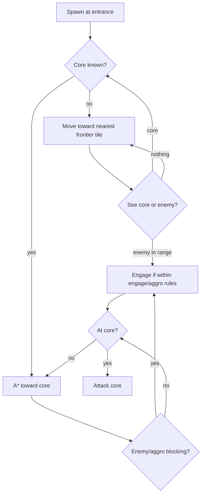

# 10 — Combat Simulation & AI

The **deterministic, seeded simulation** that resolves a wave (and H2H, `12`). This is the most safety-critical doc: the same code runs client-side (instant preview/replay) and server-side (authoritative). Both MUST produce identical results from the same inputs.

---

## 1. Determinism contract

`[R-SIM-001]` `resolve(initialState, seed) -> Timeline` is a **pure function**. No wall-clock, no `Date.now()`, no unseeded `Math.random`, no floating-point nondeterminism beyond IEEE-754 (use the same ops/order on both ends; avoid `Math` functions that differ across engines — prefer integer/fixed-point where feasible, see §9).
`[R-SIM-002]` All randomness comes from a single **seeded PRNG** (e.g., `mulberry32`/`xoshiro128**`) threaded through the sim. Each random draw is ordered and reproducible.
`[R-SIM-003]` Inputs to the sim: the **dungeon snapshot** (map, units, gear, traps, research, CL/core), the **wave definition** (generated from `(W, seed)`, `09`), and the **seed**. Output: a **Timeline** of events sufficient to (a) decide the outcome and (b) replay visually.
`[R-SIM-004]` The server result is canonical; the client may run a local preview but must reconcile to the server timeline (`16`,`12`).

---

## 2. Time model

- The sim advances in fixed **ticks**. Default `TICK_MS = 100` (10 ticks/sec).
- All durations (attack intervals, DoTs, cooldowns) are expressed in ticks (converted from seconds).
- `[R-SIM-010]` Movement and combat are resolved per tick in a fixed entity order (by stable entity id) to keep determinism.
- The Timeline records events with tick timestamps; the renderer interpolates between ticks for smooth visuals (presentation only; never affects outcome).

```ts
interface Timeline {
  seed: number;
  durationTicks: number;
  outcome: { coreSurvived: boolean; coreHpRemaining: number; waveCleared: boolean; };
  events: SimEvent[];     // ordered; spawn, move, attack, hit, status, trapTrigger, death, drop, coreHit, ...
  rewards: { dp: number; drops: GearItem[]; killBreakdown: {...} };
}
```

---

## 3. Entity & state model

Combatants (player units/turrets and adventurers) share an in-sim representation:

```ts
interface SimEntity {
  id: string;
  side: 'dungeon' | 'invader';
  pos: {x:number;y:number};      // tile (with sub-tile offset for rendering)
  stats: ResolvedStatBlock;       // base + gear + research + auras, recomputed when modifiers change
  hp: number;
  affinities: Affinities;
  abilities: Ability[];
  state: 'idle'|'moving'|'attacking'|'fleeing'|'dead';
  targetId?: string;
  cooldowns: Record<string, number>;
  statuses: StatusEffect[];       // dots, slows, roots, buffs, debuffs (with remaining ticks)
  // role/ai flags
  isTurret?: boolean; mobility?: ...; revealRadius?: number; detection?: number;
}
```

`[R-SIM-020]` **Stat resolution order** (so tier stays gear/affinity-independent but combat uses everything):
1. `base` (intrinsic, defines tier — `04`).
2. `+ research familyUpgrades/doctrines` (`06`).
3. `+ gear mods` (weapon main bonus scaled by affinity, `07`).
4. `+ active auras/buffs/debuffs` (recomputed when auras change).
The result is `ResolvedStatBlock` used by combat math. Tier is **never** recomputed from this.

---

## 4. Damage pipeline (canonical)

For a single attack from `A` to target `T` of `type ∈ {melee, ranged, arcane, holy, ...}`:

```
1. hitRoll:
   pHit = clamp( A.acc_factor * BASE_HIT - T.dodge - stealthPenalty(T) , HIT_FLOOR, HIT_CAP )
   // vs rogues, HIT_CAP = 0.9 (R-ROGUE-002); general HIT_CAP = 0.99; HIT_FLOOR = 0.2
   if rng() > pHit: emit Miss; return

2. baseDamage:
   atkStat   = A primary for type (phys/rng/mag) + gear weapon bonus
   affDmg    = atkStat * A.affinity[type]               // affinity scaling (04 §3.3)

3. critRoll:
   if rng() < A.crit: affDmg *= A.critMult; mark crit

4. mitigation:
   if type is physical (melee/ranged): 
        mit = T.def * (1 - A.armorPenFrac) - A.armorPenFlat
        dmg = affDmg * defMitigation(mit)                // see §4.1
   else if type is magic/elemental:
        mres = T.mres * (1 - A.magPenFrac) - A.magPenFlat
        dmg = affDmg * magMitigation(mres)
        // elemental: also apply T.affinity[type] as resist/vuln (04 R-AFF-004)
   else if type is 'true': dmg = affDmg                   // ignores mitigation (some traps)

5. blockRoll:
   if rng() < T.block: dmg *= (1 - BLOCK_REDUCTION)       // default .5

6. apply:
   T.hp -= max(MIN_DAMAGE, round(dmg))
   if A.lifesteal: A.hp = min(maxHp, A.hp + dmg*A.lifesteal)
   onHit abilities (cleave/splash/slow/poison) fire here
   if T.hp <= 0: death (drops, DP, onKill abilities)
```

### 4.1 Mitigation curve
`[R-SIM-030]` Defense uses a **diminishing-returns** curve, not flat subtraction, so high def is strong but never gives 100% immunity:
```
defMitigation(def) = 100 / (100 + max(0, def))      // def 100 => 50% taken; def 300 => 25% taken
magMitigation(mres) = 100 / (100 + max(0, mres))
```
Constants (`MIT_K = 100`) are config. This pairs with the stat magnitudes in `04` §2 so same-tier fights are decisive but not instant.

### 4.2 Attack cadence
`[R-SIM-031]` Each entity attacks when its `attackCooldown` reaches 0; `attackCooldown = round(TICKS_PER_SEC * BASE_ATTACK_INTERVAL / atkSpeed)`. Ranged/casters require LoS + range; melee require adjacency (range 1) or weapon range.

### 4.3 Status effects
DoTs (poison/burn/bleed), slows (×moveSpeed/atkSpeed), roots (moveSpeed→0), stuns (no act), debuffs (−stat), buffs (+stat), shields (absorb), fear (flee/threat down). Each is `{ type, magnitude, remainingTicks, sourceId }`, ticked down each tick, reapplied/refreshed per stacking rules (config: stack vs refresh per status).

---

## 5. Targeting & threat
`[R-SIM-040]` Default target selection: nearest valid enemy within acquisition range, tie-broken by **threat** weight (`threat` stat; tanks/taunts pull aggro). Some classes override:
- Assassins/rogues: prefer **lowest-HP or backline** (casters/turrets) targets, bypassing front if pathing allows.
- Clerics: "target" = lowest-HP **ally** to heal (not an attack).
- Ranged: prefer targets they can hit without moving; kite if `atkSpeed`/`moveSpeed` allow (optional v1: simple kiting for archers).
`[R-SIM-041]` Monster (dungeon) AI default: **idle at post until an enemy enters `aggroRadius`, then engage** (spec: "wait at spawn until they see an opponent then fight"). Units do **not** chase beyond a leash distance from their placed tile (so the player's formation holds). Leash default 4 tiles (config); turrets leash 0 (hold position, except flee).

---

## 6. Pathfinding & exploration (adventurers)

Spec: "pathfinding of the adventurers just explores normally, and they all share info, and if they find opponents they fight if they are close, then if they find dungeon core try to attack it."

`[R-PATH-001]` Adventurers do **not** start with map knowledge. They maintain a **shared party fog-of-war**. Movement is **frontier exploration**: head toward the nearest unexplored frontier tile reachable from current position.
`[R-PATH-002]` **Shared info**: vision, revealed traps, and known core location are shared across the whole invading party instantly (spec).
`[R-PATH-003]` Once any adventurer sees the **core**, the party's goal switches to **reach the core**; they path toward it (A* on known-walkable tiles), while still **engaging** player units that block/aggro them en route.
`[R-PATH-004]` **Engagement rule**: if an adventurer is within engage range of a dungeon unit (or one is within its aggro), it fights (front-liners hold, ranged shoot) rather than walking past into a kill-zone — but the party as a whole keeps pushing toward the core (they don't all stop for one straggler). Tunable "aggressiveness" controls push-vs-clear.
`[R-PATH-005]` **Trap avoidance**: revealed traps are treated as high-cost tiles in pathing; adventurers route around them when a viable route exists (the fair-lane guarantee, `03` §5, ensures one always exists). Hidden traps are normal-cost (they don't know).
`[R-PATH-006]` Pathfinding is **A*** with a consistent heuristic (Manhattan) and **deterministic tie-breaking** (lowest tile id) for sim reproducibility.

### 6.1 Pathfinding diagram


---

## 7. Trap resolution in sim
`[R-SIM-050]` Each tick, for movement onto/into trap trigger areas: evaluate `step`/`proximity`/`tripwire` triggers (respecting hidden vs revealed — hidden always triggers on step; revealed are avoided so rarely trigger). Apply effects via the damage/status pipeline; decrement `charges`, set `cooldownTicks`, mark consumed. Emit `trapTrigger` events. (Detail in `08`.)
`[R-SIM-051]` Rogue reveal is processed before movement resolution each tick so newly-revealed traps are avoided that same tick.

---

## 8. Sim main loop (pseudocode)

```
function resolve(state, seed):
  rng = makePRNG(seed)
  entities = buildEntities(state)        // units, turrets, traps, then spawn wave at entrance
  tl = newTimeline(seed)
  for tick in 0..MAX_TICKS:
    processStatuses(entities, tl)        // dots, expire buffs
    processRogueReveal(entities, traps, tl)
    for e in entities ordered by id:
      if e.dead: continue
      if e.side == invader: invaderAI(e, rng, tl)   // explore/path/engage/attack core
      else: dungeonAI(e, rng, tl)                   // idle->engage within leash; turret flee
    resolveMovement(entities, tl)        // apply moves, trigger traps
    resolveAttacks(entities, rng, tl)    // damage pipeline (§4)
    if core.hp <= 0: tl.outcome = LOSS; break
    if noLivingInvaders(): tl.outcome = WIN; break
  finalizeRewards(tl, state)             // DP, drops (deterministic, 07)
  return tl
```

`[R-SIM-060]` `MAX_TICKS` is a safety cap (default 60s × 10 = 600... scaled by wave size; large crusades get more). If the cap is hit with invaders alive but core alive, treat as **wave cleared** (stalemate favors defender) OR **draw** in H2H (see `12`). Tunable.

---

## 9. Determinism engineering notes (for build subagents)
`[R-SIM-070]` Use **integer/fixed-point** for positions and damage where possible; round consistently (`round` = banker's or always-half-up, pick one and centralize).
`[R-SIM-071]` Avoid `Array.sort` instability — always sort by explicit stable key (id).
`[R-SIM-072]` The sim package has **zero** dependencies on DOM, Pixi, React, Firebase, or `Date`. It is the shared core (`17`). Unit tests assert `resolve(state, seed)` is byte-identical across runs and across Node/browser.
`[R-SIM-073]` The PRNG, all config constants, and the entity-iteration order are part of the determinism contract; changing any of them invalidates stored timelines (version them — `16`).

---

## 10. Legibility outputs (pillar P1)
`[R-SIM-080]` The Timeline carries enough semantic events to drive the RESULT screen's "notable events" and live combat log: kills, trap triggers + kill counts, unique deaths, core hits, biggest hit, MVP unit, near-death moments. The renderer (`14`,`17`) consumes these.
