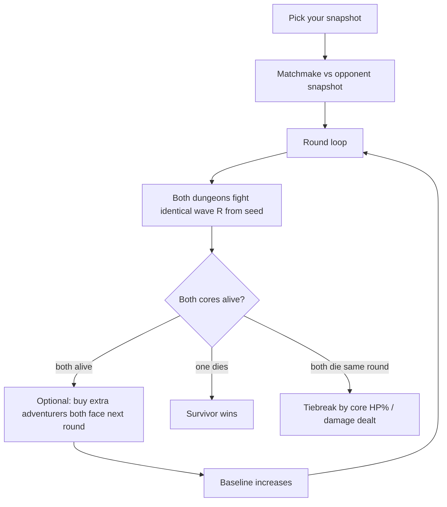
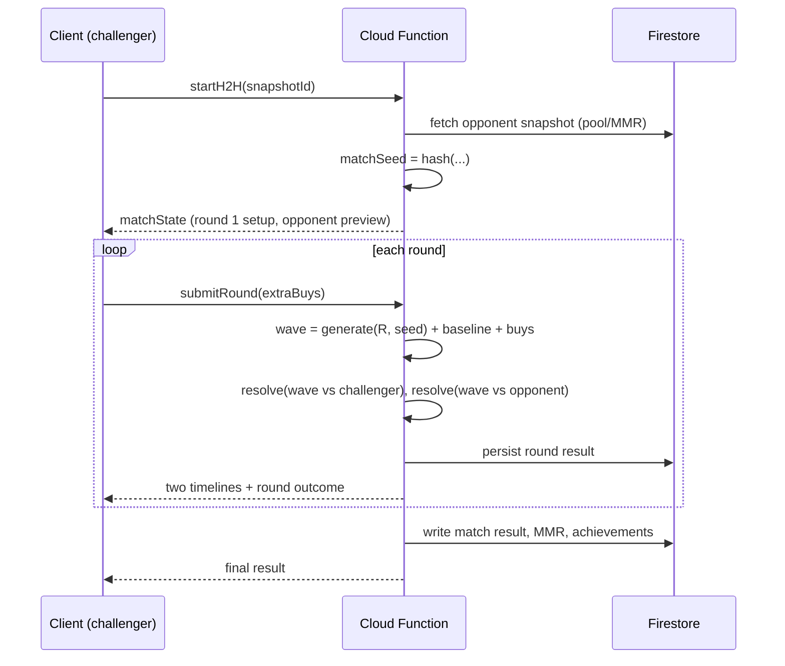

# 12 — Head-to-Head (Asynchronous PvP)

Spec: "you can pick any dungeon state that you have, and then the h2h matches are like you against an ai running the opponent, you can choose to buy adventurers to attack both of you in the next wave and see who survives longer (with a baseline that increases over time) so that games don't usually go more than 10 rounds. h2h isn't real time, you vs the bot and their last saved data."

---

## 1. Concept

H2H is **asynchronous**: there is no live opponent. You select **one of your saved dungeon snapshots** and are matched against **another player's saved snapshot** (run by AI). Both dungeons face the **same escalating waves** of adventurers each round; **whoever's core survives longer wins**. An escalating **baseline** guarantees the match ends within ~10 (max `H2H_MAX_ROUNDS`) rounds.

Key properties:
- Uses the **same deterministic sim** as normal waves (`10`) — no special combat code.
- Both sides fight **identical waves** from the **same seed** each round (fairness).
- Players can spend a per-match currency to **add extra adventurers** that attack **both** dungeons (escalation tool).

---

## 2. Match setup

`[R-H2H-001]` The challenger picks one **owned snapshot** (a saved final/retired dungeon state, `13`). The snapshot is **frozen** (units, gear, traps, map, research, CL as saved).
`[R-H2H-002]` **Matchmaking**: the server selects an opponent snapshot from the **H2H pool** (other players' opted-in snapshots) close in **strength rating** (a function of CL + total power score + wave reached; see §6). Fallback to bot-generated dungeons if the pool is thin (especially early in the game's life).
`[R-H2H-003]` Both snapshots are loaded read-only. Neither player is online; the opponent's dungeon is run **entirely by the sim/AI** using its saved configuration (its monsters use the same dungeon AI as in normal play, `10` §5).

---

## 3. Round structure

Each round `R` (1..`H2H_MAX_ROUNDS`):
1. The server **generates one shared wave** for round `R` from the match seed (`generateWave(R, matchSeed)`, `09`) **plus the current baseline** (§4) **plus any extra adventurers** both players bought (§5).
2. The **same wave** is run against **both** dungeons via two independent `resolve()` calls (same wave entities, each vs that side's dungeon, each with a per-side sub-seed derived from matchSeed so both are deterministic yet independent).
3. Record each side's result: did the core survive, core HP remaining, damage dealt to core, kills.
4. **Resolve outcome**:
   - If exactly one core died → the **survivor wins**, match ends.
   - If **both** cores survived → continue to next round (baseline escalates).
   - If **both** cores died this round → **tiebreak** (§7).
5. Between rounds, the **INVEST** step (§5) lets each side commit extra-adventurer purchases for the next shared wave. (Asynchronous: the challenger does this live; the opponent's "choices" are simulated by AI policy or simply none — see §5.3.)

`[R-H2H-010]` Because the baseline grows (`H2H_BASELINE_GROWTH=1.35`), waves quickly outscale any static dungeon, forcing a death by ~round 8–10 (design target). `H2H_MAX_ROUNDS=12` is a hard cap → if reached, tiebreak.

---

## 4. Escalating baseline

`[R-H2H-020]` Each round adds a **baseline threat** on top of the normal wave: `baseline(R) = round(H2H_BASELINE_BASE · H2H_BASELINE_GROWTH^(R-1))`. This baseline is spent generating **extra adventurers** (scaled to the snapshots' tier band) added to the shared wave. It rises fast so even strong dungeons eventually fall — guaranteeing match termination and preventing infinite stalls (spec).
`[R-H2H-021]` The baseline tier band scales with the **higher** of the two snapshots' CL, so a high-CL dungeon isn't trivially farmed by sandbagging.

---

## 5. Buying extra adventurers (the interactive lever)

Spec: "you can choose to buy adventurers to attack both of you in the next wave."

`[R-H2H-030]` Each match gives the challenger a pool of **H2H Points** (separate from DP; earned per round survived + a starting stipend). Between rounds they may **spend** H2H Points to add specific adventurers to the **next shared wave** — which attacks **both** dungeons.
`[R-H2H-031]` Strategy: you add adventurers that **your** dungeon counters but you predict the **opponent's** dungeon does not (e.g., add rogues if you have spammers/anti-rogue traps and they don't; add a horde if you have AoE and they're single-target). This is the core mind-game of H2H, expressed asynchronously.
`[R-H2H-032]` Added adventurers are drawn from the same catalog (`09`) within the allowed tier band; price in H2H Points scales with power score.

### 5.3 Opponent's "choices"
`[R-H2H-033]` Since the opponent is offline, their extra-adventurer purchases are simulated by an **AI policy** (default: a simple heuristic that buys adventurers countering the *challenger's* visible dungeon composition), OR (simpler v1) the opponent buys **nothing** and only the challenger shapes the shared wave. v1 default: **AI policy ON, conservative**, configurable. Either way it's deterministic from the match seed + snapshots.

---

## 6. Strength rating & matchmaking

`[R-H2H-040]` Each snapshot has a **rating**:
`rating = a·CL + b·totalUnitPowerScore + c·highestWaveReached + d·trapValue` (weights config). Used to find a comparable opponent.
`[R-H2H-041]` Optional **ladder/MMR**: winning vs higher-rated opponents raises your H2H MMR; matchmaking prefers similar MMR. v1 can ship rating-based matchmaking and add MMR later (reserved).
`[R-H2H-042]` Opt-in: a snapshot enters the public pool only if the player marks it shareable (default on for retired dungeons; privacy toggle in `13`).

---

## 7. Tiebreak & scoring

`[R-H2H-050]` If both cores die in the same round (or `H2H_MAX_ROUNDS` reached with both alive), tiebreak in order:
1. Higher **core HP%** at the deciding moment (more remaining = win; if both at cap, next).
2. Fewer total **rounds with core damage taken**.
3. More **adventurers killed** across the match.
4. Coin-flip from match seed (deterministic) as last resort.
`[R-H2H-051]` Match result records: winner, rounds survived (each side), MMR/rating change, rewards.

---

## 8. Rewards

`[R-H2H-060]` H2H gives **meta rewards** only (it doesn't feed a live run): cosmetic flair, achievements (`13`), MMR/ladder standing, and "H2H tokens" (reserved cosmetic currency). It must NOT grant DP into an active run (keeps PvE economy clean). Tunable.

---

## 9. Determinism, security & data flow

`[R-H2H-070]` Entire match is resolved **server-side** in Cloud Functions (`16`) from `(challengerSnapshot, opponentSnapshot, matchSeed, challengerExtraBuys)`. The client only **submits choices** and **plays back** returned timelines. No client-trusted outcomes (pillar P6).
`[R-H2H-071]` Both snapshots and the config **version** must match the sim version; mismatches re-validate or reject (`11` §7, `16`).
`[R-H2H-072]` The challenger watches **both** dungeons' replays (side-by-side or toggle) for each round (legibility, P1) — seeing exactly why they out-survived (or didn't).

### 9.1 Sequence

---

## 10. v1 scope vs reserved
- **v1**: rating-based matchmaking, shared escalating waves, challenger extra-buys, conservative opponent AI, side-by-side replay, basic ladder.
- **Reserved**: full MMR seasons, leaderboards UI, spectating others' matches, "revenge" matches, async "set a counter-buy" for when others challenge you.
