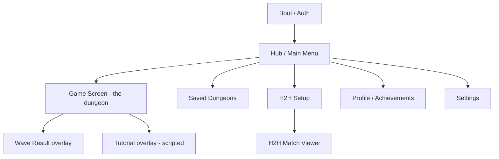

# 14 — UI / UX

Screen map, layouts, the build/shop panels, hover tooltips, drag-and-drop, the equip flow, the wave viewer, and interaction rules. Wireframe-level detail for implementers. Rendering split: **React** owns all HUD/menus/panels; **PixiJS** owns the dungeon viewport (`17`).

---

## 1. Screen map



---

## 2. Hub / Main Menu
- **Continue** (prominent if an active run exists; resumes BUILD, `01` §7).
- **New Run** (with NG+ modifier toggles if unlocked, `13`).
- **Saved Dungeons** (snapshot library: cards with name, wave reached, rating, share toggle, rename/delete, "Use in H2H").
- **Head-to-Head** (`12`).
- **Profile / Achievements** (grid of achievements, lifetime stats, H2H record, cosmetics).
- **Settings** (audio, playback default speed, reduced motion, accessibility, account/link).

---

## 3. Game Screen layout

```
┌─────────────────────────────────────────────────────────────┐
│ TOP BAR: DP 1234  | Core Lv 6 (HP 1400/1400) | Capacity 41/50 │
│          Wave 18  | Tiles 96/225 | [Scout: ▲Horde T3-5 ~18]   │
├───────────────┬─────────────────────────────────┬───────────┤
│  BUILD BAR    │                                 │  INSPECTOR │
│ (left rail)   │      PIXIJS DUNGEON VIEWPORT     │  (right)   │
│ ┌───────────┐ │   pan/zoom, grid, sprites,      │ hover/sel  │
│ │ Pickaxe   │ │   range cones, trap markers     │ details    │
│ │ Units ▼   │ │                                 │ + actions  │
│ │ Turrets ▼ │ │                                 │            │
│ │ Traps ▼   │ │                                 │            │
│ │ Research  │ │                                 │            │
│ │ Gear Shop │ │                                 │            │
│ │ Core Up   │ │                                 │            │
│ └───────────┘ │                                 │            │
├───────────────┴─────────────────────────────────┴───────────┤
│ BOTTOM: [Run Wave ▶]  speed [1× 2× 4× ⏩instant]  combat log  │
└─────────────────────────────────────────────────────────────┘
```

### 3.1 Top bar (always visible)
- DP (animated on change), Core Level + Core HP bar (+ ward), Capacity used/total, current Wave, Tiles used/cap, and the **Scout readout** of the incoming wave (group type, tier band, approx count — exactness gated by CL Full Scout, `02`).

### 3.2 Build bar (left rail) — BUILD phase tools
Each opens a panel:
- **Pickaxe** — dig mode (click/drag rectangle; shows cost & validity; red on invalid, `03`).
- **Units** — buy menu grouped by family; shows locked (research/CL) vs available; cost, space, tier, key stats. Drag a card onto a floor tile to place.
- **Turrets** — Construct turret modes (`08`).
- **Traps** — trap catalog (unlocked subset); drag onto tile.
- **Research** — opens Research panel (§6).
- **Gear Shop** — (CL≥3) stock cards, reroll, salvage (§7).
- **Core Up** — Core Level upgrade (cost, what it unlocks; confirm).

### 3.3 Inspector (right) — context panel
Shows details for the hovered/selected entity or tile:
- **Unit/turret**: portrait, name, family, tier, space, full stats (with gear deltas), affinities (band chips), equipment slots, abilities, **actions**: equip (opens inventory), move, sell. (See §5 tooltip.)
- **Trap**: type, tier, hidden rating, effect, charges, sell.
- **Enemy (during/after wave)**: class, tier, stats, abilities, current HP/statuses.
- **Empty tile**: placement hints.

### 3.4 Bottom bar
- **Run Wave** button (commits BUILD → WAVE).
- During WAVE: **playback speed** (1×/2×/4×/instant), pause, and a **combat log** (scrolling notable events, `10` §10).

---

## 4. Dungeon viewport (Pixi) interactions
`[R-UI-001]` **Pan**: drag empty space / WASD / edge-scroll. **Zoom**: wheel / pinch. Camera clamped to dungeon bounds + margin.
`[R-UI-002]` **Hover**: highlights tile; shows entity tooltip (§5) after a short delay; shows **range cones** for ranged units/turrets and **AoE radius** for traps/casters.
`[R-UI-003]` **Select**: click an entity → Inspector locks to it; shows leash radius (units) / range. Click empty → deselect.
`[R-UI-004]` **Drag-and-drop placement**: drag a buy-card or a placed unit; valid tiles highlight green, invalid red with reason tooltip. Drop commits (or shows error). (Spec: "click and drag to move units.")
`[R-UI-005]` **Trap markers**: player always sees their own traps (icon + hidden-rating ring); during a wave, reveals to enemies are indicated (e.g., trap flashes when a rogue reveals it) for legibility.
`[R-UI-006]` Visual feedback for the **path constraint**: a toggle overlay draws the current trap-free fair lane (`03` §5); edits that would break it flash the offending tiles red.

---

## 5. Hover tooltips (spec emphasizes these)

Spec: "should be able to hover over to see unit stats and stuff", "hover over unit to add equipment, see stats, affinities, etc. buying units does the same thing."

`[R-UI-010]` **Unit hover tooltip** (placed units AND buy-cards) contains:
- Name, family, tier (with tier badge color), space cost, DP cost (if buyable).
- Primary stats `hp/def/phys/mag/rng` and key secondaries (atkSpeed, range, crit, dodge as relevant).
- **Affinity chips** (e.g., `Arcane S`, `Melee F`) color-coded.
- **Equipment slots** with current items; **affinity-adjusted previews** when hovering a candidate item (green/red deltas, `07` §6).
- Abilities (icon + text).
- Quick actions: Equip, Move, Sell (placed) / Buy (card).
`[R-UI-011]` Tooltips are keyboard-accessible and pin-able (click to pin so you can interact with the equip sub-panel). Pinned tooltip = the Inspector content.
`[R-UI-012]` Tooltips reflect **live modifiers** (research/auras) so the player sees true current stats, while a small "(base T6)" note clarifies tier is from base stats (`04`).

---

## 6. Research panel
`[R-UI-020]` Per-family tabs + General; renders the dependency graph (nodes as cards, edges as prereq lines). Owned = highlighted; affordable+unlocked = actionable; CL-locked = greyed with "Unlocks at CL X"; prereq-locked = dimmed. Hover shows effect + cost + ranks. Clicking purchases (confirm for expensive). (`06`.)

---

## 7. Gear & inventory UI
`[R-UI-030]` **Inventory**: grid of items; filter by slot/type/quality; sort by tier/value. Hover shows full item card incl. which of your units would benefit (affinity match hint).
`[R-UI-031]` **Equip flow**: from a unit's Inspector, click a slot → inventory opens filtered to that slot → click/drag item to equip (tier-cap enforced, `07`). Unequip returns to inventory.
`[R-UI-032]` **Gear Shop** (CL≥3): stock cards (item card + price), **Reroll** (DP), **Salvage** drop-zone (`07`).

---

## 8. Wave viewer & result
`[R-UI-040]` During WAVE: dungeon runs; entities animate; HP bars on damaged entities; floating damage numbers (toggle); trap triggers FX; core HP bar prominent. Speed controls + pause. Click a combatant to follow + see live readout.
`[R-UI-041]` **Result overlay** (`01` §2.3): DP earned (+breakdown), drops (with "equip now?" shortcuts), casualties, notable events list, achievements unlocked. Buttons: "Back to Build" / "Invest".

---

## 9. H2H UI (`12`)
`[R-UI-050]` **Setup**: pick snapshot (cards), see opponent preview (name, rating, CL, a teaser of their dungeon), Start.
`[R-UI-051]` **Match viewer**: side-by-side (or toggle) replay of both dungeons facing the shared wave each round; round/score tracker; between rounds, the **extra-adventurer buy** panel (H2H Points, catalog, predicted-counter hints). Final result screen with rating change.

---

## 10. Visual language & accessibility
`[R-UI-060]` **Tier colors**: Bronze→Mythic use a fixed palette (also on badges/borders) consistent across units/enemies/gear. Defined in `18`.
`[R-UI-061]` **Family iconography**: each family has an icon/silhouette motif; each enemy archetype a clear silhouette (warrior/archer/mage/rogue) so waves are readable at a glance (P1).
`[R-UI-062]` **Colorblind-safe**: don't rely on color alone — pair with icons/shapes (tier badges have numerals; affinity chips have letters; valid/invalid placement uses ✓/✗ not just green/red).
`[R-UI-063]` **Reduced motion** setting: dampens screen shake/particles. **Scalable UI** for different resolutions; desktop-first, tablet-friendly (min ~1024px; touch supported for pan/zoom/drag).
`[R-UI-064]` **Performance HUD** (dev): fps, entity count, sim tick — behind a debug flag.

---

## 11. Key UX flows (step lists)

**Place a unit**: Build bar → Units → (hover cards to compare) → drag card to tile → confirm placement (auto-deducts DP, updates Capacity).
**Equip gear**: hover/select unit → click slot → inventory (filtered) → drag item → stats update with affinity deltas.
**Dig a corridor**: Pickaxe → drag rectangle of stone → cost preview → release to dig (validates adjacency, cap, path).
**Upgrade core**: Core Up → review unlocks → confirm → capacity/size/HP/feature update.
**Run & watch**: Run Wave → set 2× → watch → Result → Invest.
**H2H**: Hub → H2H → pick snapshot → watch rounds, buy counters → result.
