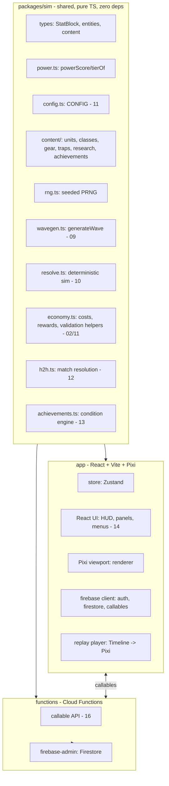

# 17 — Architecture

Frontend/engine architecture: the React↔Pixi boundary, the shared deterministic `sim/` core, state management, the entity model, save/load, and the asset pipeline. Implements the stack from `00` against the Firebase backend (`16`).

---

## 1. High-level module map



`[R-ARCH-001]` `packages/sim` is the **single source of game logic**. It has **no** dependency on React, Pixi, Firebase, DOM, or `Date`. Both the client and Cloud Functions import it. This guarantees identical results (pillar P6, `10` §1).

### 1.1 Repo layout (proposed)
```
/app                      # existing Vite React app (frontend)
  /src
    /sim                  # OR a shared package; v1: a folder imported by both (see §1.2)
    /game                 # client-only game glue
      /pixi               # renderer, sprites, camera, FX
      /react              # HUD, panels, screens (14)
      /state              # zustand stores
      /net                # firebase client wrappers (auth, firestore, callables)
      /replay             # Timeline playback
    firebase.ts           # (exists) client SDK init
/functions                # existing Cloud Functions
  /src
    /sim                  # SAME sim code (see §1.2 for sharing strategy)
    index.ts              # callables (16 §3)
/docs                     # this suite
```

### 1.2 Sharing the sim between app & functions
Options (pick in build phase, recommend A for simplicity given current scaffold):
- **A. Shared folder + path alias / build copy**: keep `sim/` in one place; both `app` and `functions` reference it (TS project references, or a small `prebuild` copy/symlink). Simple, no publishing.
- **B. Local workspace package** (`packages/sim`, npm workspaces): cleanest long-term; requires converting to a workspaces monorepo.
`[R-ARCH-002]` Whatever the mechanism, there is exactly **one** compiled sim; never fork it. A test runs the same `resolve(state,seed)` in Node and jsdom/browser and asserts identical output.

---

## 2. The sim core (engine)

`[R-ARCH-010]` `sim/` exports pure functions and data:
- `powerScore`, `tierOf` (`04`).
- `CONFIG` (`11`) + content catalogs (`05`–`09`,`13`) as typed data.
- `generateWave(W, seed, config)` (`09`).
- `resolve(state, seed) -> Timeline` (`10`).
- `resolveH2HRound(...)` (`12`).
- `economy` helpers: `unitCost`, `digCost`, `clUpgradeCost`, `dpKill`, validation predicates (used by both client preview and server authority).
- `evaluateAchievements(counters, profile)` (`13`).
`[R-ARCH-011]` Deterministic engineering per `10` §9 (fixed iteration order, seeded RNG, fixed-point where needed). Extensive unit tests + golden timelines.

### 2.1 Entity/ECS model
`[R-ARCH-012]` The sim uses a lightweight **entity model** (not a heavy ECS lib): `SimEntity[]` with systems applied each tick (status → AI → movement → combat). Data-oriented arrays optional for perf on big crusades. Abilities/effects are data (`04` §6) interpreted by effect handlers.

---

## 3. Client architecture

### 3.1 React ↔ Pixi boundary
`[R-ARCH-020]` **React** renders everything that is DOM/HTML: HUD, top bar, build bar, inspector, panels, menus, overlays, tooltips (`14`).
`[R-ARCH-021]` **Pixi** renders the **dungeon viewport only**: tilemap, unit/trap/enemy sprites, range cones, FX, damage numbers, camera. It lives in a single `<canvas>` mounted by a React wrapper component; React never touches Pixi display objects directly.
`[R-ARCH-022]` Communication:
- React → Pixi: via a typed **PixiController** API (`setBuildState`, `highlightTiles`, `playTimeline`, `setCamera`, `setHover`) and by subscribing the controller to the Zustand store.
- Pixi → React: via callbacks/events (`onTileClick`, `onEntityHover`, `onEntitySelect`) that dispatch to the store.
`[R-ARCH-023]` Single shared **Zustand store** is the source of UI truth; both React and the PixiController read it. Game/run truth comes from the server (`16`) and is mirrored into the store.

### 3.2 State management (Zustand slices)
- `authSlice` (user, profile).
- `runSlice` (RunState mirror: map, units, traps, dp, CL, research, inventory).
- `uiSlice` (selected tool, selection/hover, panel open states, camera, playback speed).
- `waveSlice` (current Timeline, playback cursor, combat log).
- `h2hSlice` (match state).
- `metaSlice` (achievements, snapshots list, settings).
`[R-ARCH-024]` Mutations that affect game truth call **callables** (`16`); the store applies an **optimistic** update and reconciles/rolls back on server response.

### 3.3 Rendering & replay
`[R-ARCH-030]` BUILD phase: Pixi renders the static dungeon from `runSlice`; interactions (place/dig/move) update store → optimistic → server.
`[R-ARCH-031]` WAVE phase: client receives a `Timeline` (`10`) from `resolveWave`; the **replay player** advances a cursor through events at the chosen speed, driving Pixi sprite spawns/moves/attacks/deaths/FX and the combat log. Interpolation between ticks for smoothness. "Instant" jumps to the end and shows the result.
`[R-ARCH-032]` Optional **local preview**: the client can run `resolve()` locally during BUILD for a "what-if" estimate, but the authoritative playback is always the server timeline.

### 3.4 Pixi rendering details
- **Tilemap**: chunked container of tile sprites (stone/floor/core/entrance); culling for large dungeons.
- **Sprites**: unit/enemy/trap sprites from texture atlases (`18`); animation via spritesheet frames or simple tweens.
- **Overlays**: range cones (Graphics), AoE radii, fair-lane overlay (`14` R-UI-006), placement highlights.
- **FX layer**: damage numbers, hit sparks, trap triggers, deaths; respects reduced-motion (`14`).
- **Camera**: a world container with pan/zoom; clamped; coordinate helpers tile↔world↔screen.
`[R-ARCH-040]` Performance budget: must handle a 60-unit crusade + dungeon at 60fps on mid hardware; use object pooling for sprites/FX, atlas batching, and cull off-screen.

---

## 4. Networking & offline
`[R-ARCH-050]` Firebase client wrappers in `/net`: auth (anon/email/google, link), Firestore subscription to `run/active`, typed callable invokers (`16` §3) with error mapping (`R-API-010`).
`[R-ARCH-051]` Graceful handling of latency: optimistic UI + reconciliation; queue mutations if offline and replay on reconnect (best-effort; server remains authority).
`[R-ARCH-052]` Local sim makes the game feel instant even with server round-trips for authority.

---

## 5. Save/load flow
`[R-ARCH-060]` Load: on enter game, `getActiveRun` (or subscribe) → hydrate `runSlice` → Pixi builds the scene. New run via `startRun`.
`[R-ARCH-061]` Save: autosave is implicit — every authoritative mutation persists server-side (`16`); the client doesn't manage save files. Settings/profile persist via `updateProfile`.
`[R-ARCH-062]` Snapshots created by `retireRun`/run-death; listed via `metaSlice`.

---

## 6. Asset pipeline (see `18`)
`[R-ARCH-070]` Sprites packed into **texture atlases** (e.g., via free tooling / `@assetpack` or manual TexturePacker) loaded by Pixi `Assets`. A manifest maps content ids → texture frames so content (`05`–`09`) references art by id. Placeholder art generated procedurally/colored shapes until real sprites land (graceful degradation: missing texture → tinted shape + label).

---

## 7. Build, test, deploy
`[R-ARCH-080]` **Build**: Vite builds `app` → `app/dist` → Firebase Hosting (firebase.json already points there). Functions build via `tsc` (scaffolded).
`[R-ARCH-081]` **Tests**: 
- `sim` unit tests (determinism, power/tier, economy, wavegen) — fast, pure.
- Golden timeline tests (snapshot of `resolve()` output for fixed seeds).
- Balance smoke battery (`11` §5) as a reportable test.
- Client component tests for critical flows (placement validation, equip).
`[R-ARCH-082]` **CI**: typecheck + lint + sim tests + build on PR. Determinism test runs in both Node and a browser-like env.
`[R-ARCH-083]` **Deploy**: `firebase deploy` (hosting + functions + rules + indexes). Functions need Blaze.

---

## 8. Tech choices summary
| Concern | Choice | Why |
|--------|--------|-----|
| UI | React + TS | rich HUD/menus, ecosystem |
| Dungeon render | PixiJS (WebGL) | many sprites/FX at 60fps (`00`) |
| State | Zustand | simple, fast, no boilerplate |
| Build | Vite | already scaffolded, fast |
| Backend | Firebase (Auth/Firestore/Functions) | scaffolded; serverless authority |
| Sim | shared pure TS | determinism across client/server |
| Hosting | Firebase Hosting | scaffolded |

`[R-ARCH-090]` Keep external deps minimal in `sim` (zero) and modest in client (Pixi, React, Zustand, Firebase). Avoid heavy game frameworks (Phaser) to keep the React+Pixi split clean.
