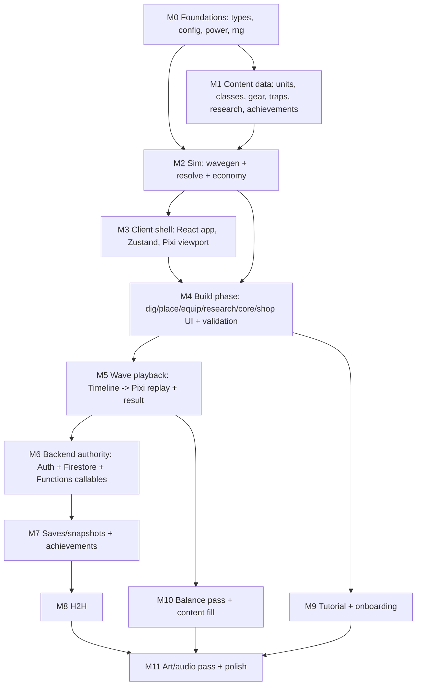

# 20 — Build Roadmap & Subagent Task Breakdown

How to turn this PRD into the game. Defines milestones, dependency order, and a **subagent task breakdown** (which doc → which build task) so the build phase can be parallelized correctly. Each task lists its inputs (docs), outputs (code), dependencies, and definition of done (DoD).

---

## 1. Guiding principles for the build
1. **Sim core first, everything depends on it.** Build `sim/` (types, power, config, content, rng, wavegen, resolve, economy) before UI or backend authority.
2. **Placeholders over polish.** Use placeholder art/audio (`18`) so logic never blocks on assets.
3. **Determinism is sacred.** Golden-timeline tests from day one (`10` §9).
4. **Vertical slice early.** Get one playable loop (dig → place → wave → reward) working end-to-end before breadth.
5. **Server authority can lag.** Build with local sim first; wire Cloud Functions authority once the loop works (the sim is identical, so it's a transport swap).

---

## 2. Dependency graph

---

## 3. Milestones & DoD

### M0 — Foundations (`sim/` skeleton)
- Inputs: `04`, `11`, `17`.
- Build: `StatBlock`/`Affinities`/`Ability`/entity & content **types**; `config.ts` (`CONFIG`); `power.ts` (`powerScore`/`tierOf`); `rng.ts` (seeded PRNG); test harness.
- DoD: `tierOf` matches `19` thresholds; PRNG deterministic; CI runs sim tests.

### M1 — Content data
- Inputs: `05`,`06`,`07`,`08`,`09`,`13`,`19`.
- Build: typed catalogs in `sim/content/` — units, adventurer classes (+tweened tiers), uniques, gear defs/affixes, traps, research tree, achievements, ability library.
- DoD: `content.test.ts` passes all checks (`19` §12), especially `tierOf(stats)==tier` for every unit/class.

### M2 — Simulation
- Inputs: `09`,`10`,`11`,`02`.
- Build: `wavegen.ts` (`generateWave`), `resolve.ts` (full tick sim: AI, pathfinding, damage pipeline, traps, statuses, rewards, Timeline), `economy.ts` (costs/rewards/validators), `h2h.ts` stub.
- DoD: deterministic golden timelines; balance smoke battery (`11` §5) runs and reports; a scripted dungeon vs scripted wave produces expected outcome.

### M3 — Client shell
- Inputs: `17`,`14`.
- Build: React app structure, Zustand slices, Firebase client init (exists), Pixi viewport wrapper + PixiController, camera/pan/zoom, tilemap render from a RunState, placeholder art manifest + fallback renderer (`18`).
- DoD: can render a hardcoded dungeon, pan/zoom, hover a tile.

### M4 — Build phase (the management game)
- Inputs: `02`,`03`,`06`,`07`,`08`,`14`.
- Build: build bar + panels (units/turrets/traps/research/gear/core), dig tool (incl. drag-rect + path validation overlay), drag-drop placement/move/sell, hover tooltips + inspector, equip flow, research panel, core-up, gear shop; all using `economy.ts` validators locally.
- DoD: a full BUILD phase is playable locally (no server yet); all `03`/`02` rules enforced with clear reasons.

### M5 — Wave playback & result
- Inputs: `10`,`14`,`01`.
- Build: call local `resolve()`, play the Timeline through Pixi (spawns/moves/attacks/deaths/trap FX/damage numbers/combat log), speed controls, follow-cam; Result overlay (DP/drops/casualties/notable events/achievements).
- DoD: end-to-end local loop: dig→place→equip→run wave→watch→rewards→invest, with revive rule (`01` §5).

### M6 — Backend authority
- Inputs: `16`,`13`,`17`.
- Build: Auth (anon/email/google + link), Firestore schema + rules extension, Cloud Functions callables (`16` §3) using shared `sim/`; switch client mutations to callables with optimistic UI + reconciliation; `resolveWave` authoritative.
- DoD: a run persists server-side; resume works; DP/results are server-granted; rules deny client economy writes. (Functions need Blaze.)

### M7 — Saves, snapshots & achievements
- Inputs: `13`,`16`.
- Build: active-run autosave, retire/death → Snapshot, snapshot library UI, achievements engine (server-evaluated) + toasts + profile page, NG+ modifiers.
- DoD: death/retire produces a snapshot; achievements unlock from real events; meta persists across runs.

### M8 — H2H
- Inputs: `12`,`16`.
- Build: matchmaking from snapshot pool (rating), `startH2H`/`submitH2HRound`, shared-wave + baseline + extra-buys, two-sided resolve, side-by-side replay UI, results/MMR.
- DoD: a full async H2H match resolves deterministically server-side and is watchable; ends within `H2H_MAX_ROUNDS`.

### M9 — Tutorial & onboarding
- Inputs: `15`.
- Build: data-driven step machine, coachmarks, gated UI, scripted waves, JIT tips.
- DoD: a new player completes the 15-step tutorial and lands in a real run.

### M10 — Balance pass & content fill
- Inputs: `11`,`05`,`09`.
- Build: tune `CONFIG` against the anchor checks (`11` §5) via the smoke battery; fill any tweened/missing content; income/CL pacing notebook.
- DoD: anchor-fight checks in range; pacing targets (`01` §8) roughly met.

### M11 — Art/audio pass & polish
- Inputs: `18`,`14`.
- Build: replace placeholders per `18` §8 phases; audio; FX polish; accessibility/perf pass (60fps crusade).
- DoD: cohesive look, licensed assets w/ attributions, perf budget met.

---

## 4. Subagent task breakdown (parallelizable)

Once M0–M2 (the shared core) exist, much can parallelize. Suggested independently-ownable tasks:

| Task | Owns | Primary docs | Depends on | Parallel-safe after |
|------|------|--------------|------------|---------------------|
| T-types | `sim/types`, `config`, `power`, `rng` | 04, 11, 17 | — | start |
| T-content-units | unit catalog | 05, 19 | T-types | M0 |
| T-content-enemies | class/unique catalog | 09, 19 | T-types | M0 |
| T-content-gear | gear/affix catalog | 07, 19 | T-types | M0 |
| T-content-traps | trap catalog | 08, 19 | T-types | M0 |
| T-content-research | research tree | 06, 19 | T-content-units | M0+units |
| T-content-ach | achievements defs | 13, 19 | T-types | M0 |
| T-sim-wavegen | `generateWave` | 09, 11 | T-content-enemies | M1 |
| T-sim-resolve | tick sim, damage, AI, pathing, traps | 10, 11 | all content | M1 |
| T-sim-economy | costs/rewards/validators | 02, 11 | T-types | M0 |
| T-client-shell | React+Pixi shell, store | 17, 14 | T-types | M0 |
| T-client-build | build phase UI + validation | 02,03,06,07,08,14 | shell, economy | M3+M2economy |
| T-client-replay | Timeline → Pixi playback + result | 10,14,01 | shell, resolve | M3+M2 |
| T-backend | Auth, rules, callables | 16,13 | sim, economy | M2 |
| T-saves-ach | snapshots + achievements engine | 13,16 | backend | M6 |
| T-h2h | H2H end-to-end | 12,16 | backend, resolve | M6 |
| T-tutorial | onboarding | 15 | client-build | M4 |
| T-balance | tuning + smoke battery | 11 | resolve+content | M2 |
| T-art | manifest, placeholders, real art | 18 | shell | M3 |

`[R-ROAD-001]` **Coordination rule for subagents**: never re-derive tier (`04`), never duplicate `CONFIG` (`11`), never fork the sim (`17`). All numbers come from `sim/config.ts`; all content from `sim/content/`. Cross-check against the `19` content tests.
`[R-ROAD-002]` Each task ships with tests; the content/determinism/balance tests (`19` §12, `10` §9, `11` §5) are the shared contract that keeps parallel work consistent.

---

## 5. Suggested first vertical slice (fastest path to "it's a game")
1. T-types (M0).
2. Minimal content: just goblinoid T1–T3 units + warrior/archer T1–T3 classes + 3 traps + a few research nodes.
3. T-sim-economy + T-sim-wavegen + T-sim-resolve (enough for those).
4. T-client-shell + T-client-build + T-client-replay (local sim, no backend).
5. Play the loop locally. Then add backend authority (M6), then breadth (rest of content), then H2H/tutorial/art.

`[R-ROAD-003]` This slice proves the fun (pillars P1/P2) before investing in the full roster, backend, and H2H.

---

## 6. Risk register
| Risk | Mitigation |
|------|------------|
| Client/server sim drift | Single shared `sim/`, golden tests in both envs (`17` R-ARCH-002) |
| Pixi perf on big crusades | Pooling, atlas batching, culling; perf budget tests (`17` §3.4) |
| Balance feels off | Smoke battery + tuning notebook; all numbers in `CONFIG` (`11`) |
| Firestore doc size limits | Sparse map, compact lists, shard if needed (`16` §5) |
| Functions require Blaze | Use emulator in dev; document billing requirement (`16`,`00`) |
| Content inconsistency across subagents | `19` §12 content tests as CI gate; coordination rule R-ROAD-001 |
| Scope creep | Reserved-design-space sections keep v1 bounded (`01` §6, `12` §10) |

---

## 7. Definition of "v1 done"
A player can: sign in, complete the tutorial, play an endless run (dig/build/equip/research/upgrade/watch waves) that escalates and eventually ends, earn achievements, retire/lose into a saved snapshot, and play an async H2H match against another snapshot — all server-authoritative and deterministic, with placeholder-or-better art and basic audio.
